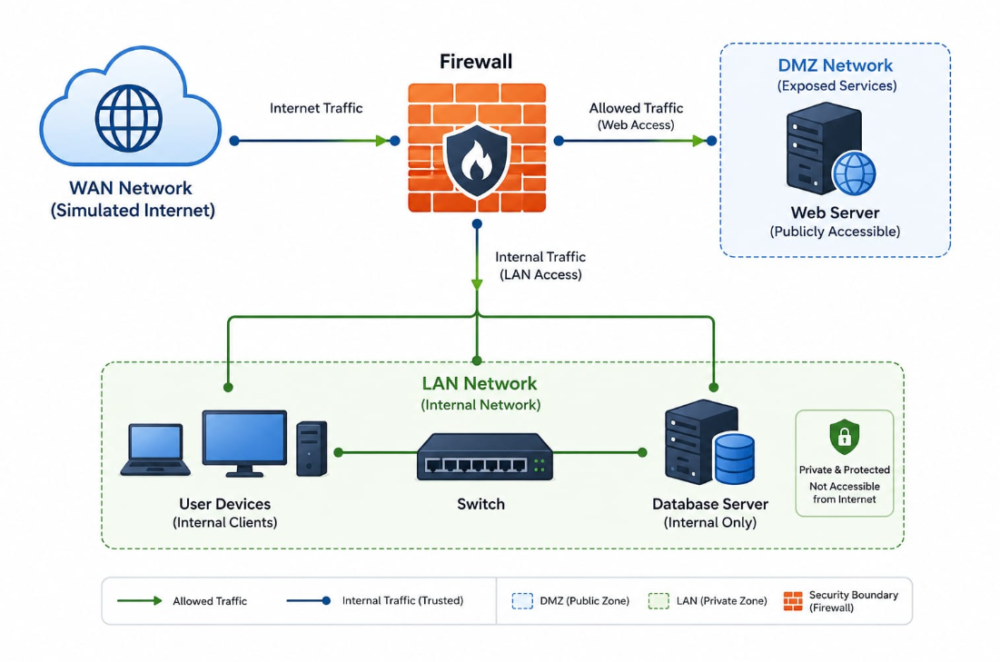

# Infraestructura de red segura con pfSense y DMZ

Proyecto de sistemas y redes centrado en el diseño e implementación de una infraestructura de red segmentada mediante **pfSense**, simulando un pequeño entorno empresarial.

La red se divide en tres zonas principales: **WAN**, **LAN** y **DMZ**. pfSense actúa como firewall central y controla el tráfico entre ellas mediante reglas de filtrado y NAT.

En la DMZ se aloja un servidor Ubuntu con servicios web públicos, manteniéndolo separado de la red interna.

## Objetivos

- Diseñar una infraestructura segmentada en WAN, LAN y DMZ.
- Utilizar pfSense como firewall principal.
- Controlar el tráfico entre las diferentes redes.
- Aplicar el principio de mínimo privilegio.
- Desplegar un servidor web en la DMZ.
- Publicar el servicio web mediante NAT.
- Impedir el acceso directo desde la DMZ hacia la LAN.
- Comprobar el funcionamiento mediante pruebas de conectividad y seguridad.

## Arquitectura

La infraestructura está formada por tres redes:

- **WAN:** simula la conexión con una red externa.
- **LAN:** contiene los equipos de la red interna.
- **DMZ:** aloja los servicios que pueden ser accesibles desde el exterior.

**pfSense** dispone de una interfaz para cada red y actúa como punto central para el enrutamiento y filtrado del tráfico.

## Direccionamiento

| Red | Dirección | Función |
|---|---|---|
| LAN | `10.0.0.0/24` | Red interna |
| DMZ | `172.16.0.0/24` | Servicios públicos |
| WAN | `192.168.1.0/24` | Red externa simulada |

## Tecnologías utilizadas

`pfSense` `VirtualBox` `Ubuntu Server` `Linux` `Apache` `DNS` `HTTPS` `NAT` `Firewall` `Nmap`
